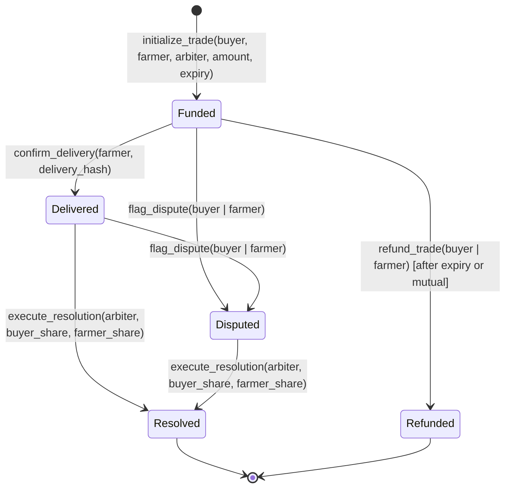

# Escrow State Machine

The AgriResolve smart contract enforces a deterministic finite state machine (FSM). Every state change is bounded by explicit caller authentication, state validity checks, and integer balance conservation.

---

## State Definitions

```rust
#[contracttype]
#[derive(Clone, Copy, Debug, Eq, PartialEq)]
#[repr(u32)]
pub enum EscrowState {
    Funded = 0,
    Delivered = 1,
    Disputed = 2,
    Resolved = 3,
    Refunded = 4,
}
```

| State | Code | Description | Valid Next States |
|---|:---:|---|---|
| `Funded` | `0` | Buyer deposited settlement tokens into contract custody. | `Delivered`, `Disputed`, `Refunded` |
| `Delivered` | `1` | Farmer submitted cryptographic delivery confirmation hash. | `Disputed`, `Resolved` |
| `Disputed` | `2` | Trade locked due to non-conformance. Payouts require arbiter split. | `Resolved` |
| `Resolved` | `3` | Arbiter executed atomic split payout between buyer and farmer. Terminal state. | *None* |
| `Refunded` | `4` | Trade canceled or expired; principal returned to buyer. Terminal state. | *None* |

---

## State Transition Diagram



---

## Transition Invariants & Rules

### 1. `initialize_trade`
- **Precondition:** Caller must be the designated `buyer`. `amount > 0`. `expiry > current_ledger_timestamp`.
- **Token Movement:** Calls SEP-41 token client `transfer(buyer, contract_address, amount)`.
- **Postcondition:** Trade stored with state `EscrowState::Funded`. `delivery_hash` initialized to zero bytes.

### 2. `confirm_delivery`
- **Precondition:** Caller must be the designated `farmer`. Current state must be `EscrowState::Funded`.
- **Postcondition:** State transitions to `EscrowState::Delivered`. `delivery_hash` recorded on-chain. Emits `delivery_confirmed` event.

### 3. `flag_dispute`
- **Precondition:** Caller must be either `trade.buyer` OR `trade.farmer`. Current state must be either `EscrowState::Funded` OR `EscrowState::Delivered`.
- **Postcondition:** State transitions to `EscrowState::Disputed`. Any unilateral refund or standard delivery completion is locked. Emits `dispute_flagged` event.

### 4. `execute_resolution`
- **Precondition:** Caller must be the authorized `trade.arbiter`. Current state must be `EscrowState::Disputed` (or `Delivered`).
- **Mathematical Invariant:** `buyer_share.checked_add(farmer_share) == Some(trade.amount)`. Neither share may be negative.
- **Token Movement:**
  - If `buyer_share > 0`: `token_client.transfer(contract_address, buyer, buyer_share)`
  - If `farmer_share > 0`: `token_client.transfer(contract_address, farmer, farmer_share)`
- **Postcondition:** State transitions to `EscrowState::Resolved`. Emits `resolution_executed` event with exact shares.

### 5. `refund_trade`
- **Precondition:** Caller must be `trade.buyer` (after `trade.expiry`) OR `trade.farmer` (consensual return). Current state must be `EscrowState::Funded`.
- **Token Movement:** `token_client.transfer(contract_address, buyer, trade.amount)`.
- **Postcondition:** State transitions to `EscrowState::Refunded`. Emits `trade_refunded` event.

---

## Ledger Storage & TTL Management

All trade records are stored in Soroban **Persistent Storage**:
- Key layout: `DataKey::Trade(u64)` and `DataKey::TradeCount`.
- On every read and write, the contract invokes `env.storage().persistent().extend_ttl(...)` with:
  - `threshold`: 172,800 ledgers (~10 days)
  - `extend_to`: 518,400 ledgers (~30 days)

This ensures active escrows and historical trade receipts never expire or incur rent eviction while awaiting inspection or arbitration.
